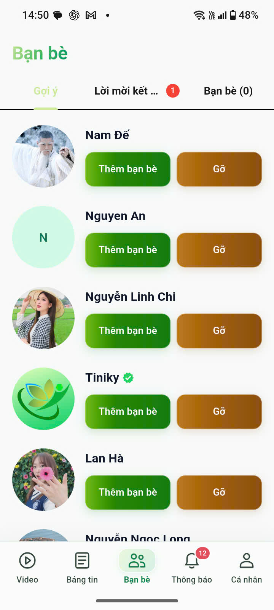

# Tiniky and Quantitative Research Portfolio

A portfolio of software development and quantitative research work by Thanh Tran.

## [Business performance dashboard](business-dashboard/)

A Python and Streamlit demonstration with synthetic order data, interactive filters, revenue visualizations and CSV export. See the [dashboard instructions](business-dashboard/README.md) for setup and details.

## Tiniky — Flutter social application

The `social_app/` directory contains source for a Flutter social networking application with Android support and a Supabase backend. Screenshots provided by the developer appear in `screenshots/`. The app support and policy page is [available here](https://tiniky-support.rosymochi17.chatgpt.site/).

Project-specific service credentials, generated configuration and database exports are excluded. Running the app requires independently configured services and dependencies; the included source has not been validated against a fresh environment.

### Application screens

| Profile | Connections | Feed | Video |
|---|---|---|---|
|  |  |  |  |

## Forex modelling and MT5 research

The `quant-research/` directory includes an LSTM training script, a strategy backtest script, and an MT5 trading bot notebook. Notebook outputs are cleared to avoid exposing account information. These are research materials, not evidence of live profitability. The scripts may require local datasets, model files, dependencies and MetaTrader configuration not included here. Do not run live-order code without reviewing it and testing in a controlled environment.

No model accuracy or trading return is claimed here.
