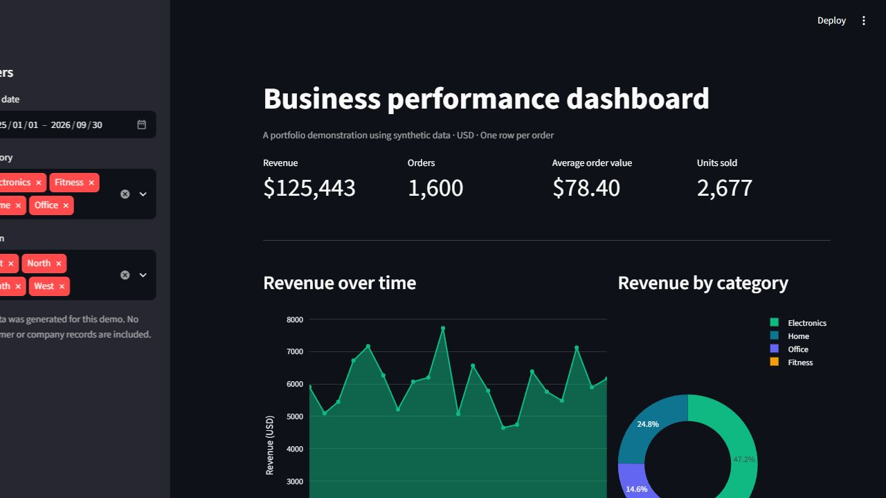

# Business performance dashboard

An interactive Python and Streamlit portfolio demo for exploring business orders. **All records are synthetic** and the project is not presented as a client engagement or actual business performance.



## Features

- Filter by order date, category and region; export the filtered orders to CSV.
- Revenue, order count, units sold and average order value.
- Monthly revenue, category mix, regional performance and top products.
- Empty-selection handling and a reproducible sample data generator.

The sample is one row per order, with a single product and category per order. Revenue is the sum of order values and average order value is revenue divided by the number of orders. Amounts are in USD. These are descriptive summaries, not forecasts or causal analysis.

## Run locally

```bash
cd business-dashboard
python -m venv .venv
# Windows PowerShell: .venv\Scripts\Activate.ps1
# macOS/Linux: source .venv/bin/activate
pip install -r requirements.txt
streamlit run app.py
```

To recreate the deterministic sample dataset, run `python generate_sample_data.py` from this directory. Generating new data overwrites `data/orders.csv`.

Built as a portfolio example. Before adapting it for real data, check the schema, currency, returns, access controls and data quality against the business requirements.
